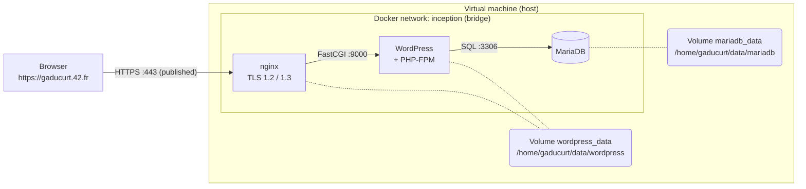

# Inception

*This project has been created as part of the 42 curriculum by gaducurt.*

## Description

A small but complete web infrastructure, built with Docker Compose inside a virtual machine: an nginx web server (HTTPS only), a WordPress site running on PHP-FPM, and a MariaDB database, each one in its own container.

### Goal
The goal of the project is to learn how to design, build and run a multi-service infrastructure with Docker, without using ready-made service images. Every image is built from a Dockerfile written for this project, on top of a plain Debian image.


### Overview
 
| Service | Role | Port | Exposed to the host |
|---|---|---|---|
| `nginx` | Only entry point. Terminates TLS (1.2 / 1.3) and forwards PHP requests to PHP-FPM | 443 | **yes** |
| `wordpress` | WordPress and PHP-FPM (no web server inside) | 9000 | no |
| `mariadb` | SQL database used by WordPress | 3306 | no |


Only port 443 of nginx is published outside the virtual machine.

### Project Description
#### Docker
Docker runs each service in an isolated container built from an image.
- Each service has its own `Dockerfile`. each instruction creates a new layer of the image: installing packages, copying configuration files, preparing folders
- The images are built from `debian:bookworm`
- `docker-compose.yml` describes the three services, their network, their volumes, their secrets and their dependencies. One `make` builds and starts everything.

<!-- Docker is a containerization tool that allows you to run applications in a containerized environment.
You can create multiple containers for a single application, which reduces the risk of crashes and deployment issues.
For this project, I need to build three dockers, the first with a `MariaDB` data base, the second with `Wordpress`, and the last with an `Nginx` server. -->

<!-- ##### Docker File
Each container work with an image built with the `Dockerfile`.
Each line build a new image with the rights dependences. -->

<!-- ##### Docker Compose
To create multiple images, a `docker-compose.yml` build all images and run the containers. -->

<!-- ##### Nginx
It is a `http` server which host the `Wordpress` application.

##### WordPress
It is an application which work with a `MariaDB` database.

##### MariaDB
It is an `sql` database. -->

### Comparisons

**Virtual Machines vs Docker**. A virtual machine virtualizes hardware and runs a complete operating system with its own kernel: strong isolation, but heavy and slow to start. A container shares the kernel of its host and only isolates processes, files and network: it is much lighter and starts in seconds, but isolates less strongly. Here, a VM is the environment in which the project runs, and Docker runs the three services inside it.

**Secrets vs Environment Variables**. Environment variables are simple to use, but they are visible with `docker inspect` and `env` inside the container. Docker secrets are mounted as files in `/run/secrets/`, only in the services that declare them, and do not appear in the environment. This project uses secrets for the passwords (`secrets/*.txt`) and a `.env` file for non-sensitive settings (domain name, user names, database name).

**Docker Network vs Host Network**. A user-defined bridge network gives the containers a private network with an internal DNS: services reach each other by name (`mariadb`, `wordpress`) and nothing is reachable from outside unless a port is published. With the host network, a container uses the network of the host directly, with no isolation. Here, only nginx publishes a port (443).

**Docker Volumes vs Bind Mounts**. A Docker volume is created and managed by Docker (stored under /var/lib/docker/volumes/). A bind mount maps an existing path of the host into the container. This project uses named volumes bound to a host folder (driver: local with driver_opts of type none and option bind): Compose and Docker manage them like volumes, while the data lives in /home/gaducurt/data/mariadb and /home/gaducurt/data/wordpress on the host, as the subject requires.

## Instruction

#### Prerequisites

#### Configuration

Credentials are not in the repository. Create them before the first run (details and a template are in `DEV_DOC.md`):

`srcs/.env`: non-sensitive settings (domain name, database name and user, WordPress user names and e-mails)
`secrets/db_password.txt`: password of the WordPress database user
`secrets/db_root_password.txt`: password of the MariaDB root user
`secrets/credentials.txt`: two lines, `WP_ADMIN_PASSWORD=`... and `WP_USER_PASSWORD=`...

```bash
git clone git@github.com:tiegd/Inception.git
cd Inception
make
```
Then open:

- https://gaducurt.42.fr for the website (accept the self-signed certificate warning)
- https://gaducurt.42.fr/wp-admin to log in to the administration panel

### Makefile targets

| Command | Effect |
|---|---|
| `make` | Check the secrets, create the data folders, build the images and start the containers |
| `make stop` / `make start` | Stop / restart the containers without removing them |
| `make down` | Remove the containers and the network (data is kept) |
| `make restart` | `down` followed by `up` |
| `make logs` | Follow the logs of all services |
| `make ps` | Show the state of the containers |
| `make clean` | Remove containers, network, images and Docker volumes (data on the host is kept) |
| `make fclean` | `clean`, then **delete all data** in `/home/gaducurt/data` |
| `make re` | `fclean`, then `make` |

### More documentation
- [USER_DOC.md](USER_DOC.md): how to use the stack (start, stop, access, credentials, checks)
- [DEV_DOC.md](DEV_DOC.md): how to set up, build, debug and where the data lives

### For display wordpress tables in mariadb container

```bash
docker exec -it mariadb mariadb -u root -p
```
```sql
show databases;
use wordpress
show tables;
select wp_users;
select * from wp_users;
select user_login from wp_users;
```
or just :
```sql
use wordpress select user_login from wp_users;
```

### Test in case of crash

```bash
PID=$(docker inspect --format '{{.State.Pid}}' wordpress)
kill -9 $PID
docker ps
docker inspect --format '{{.RestartCount}}' wordpress
```

## Resources
#### Docker
- https://blog.stephane-robert.info/docs/conteneurisation/
#### Nginx
- https://fr.wikipedia.org/wiki/Nginx
- https://hub.docker.com/hardened-images/catalog/dhi/nginx
- https://medium.com/@jayprakash01/understanding-cgi-fastcgi-and-php-fpm-in-nginx-with-php-applications-a6a6c0b7b91d
#### WordPress
- https://developer.wordpress.org/advanced-administration/wordpress/wp-config/
- https://github.com/WordPress/WordPress/blob/master/wp-config-sample.php
#### MariaDB
- https://mariadb.org/documentation/
- https://en.wikipedia.org/wiki/MariaDB

## Use of AI
An LLM was use to explaine some notions and as a debugging assistant.
Also for review the README.md and correct any errors.
