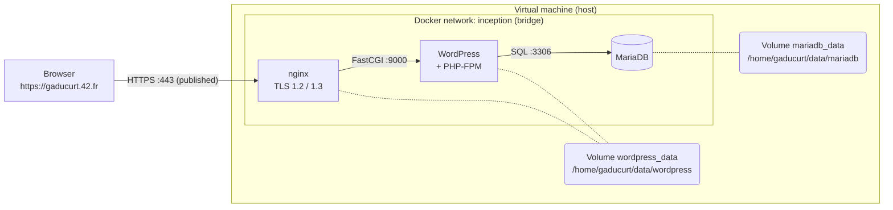

# Inception

*This project has been created as part of the 42 curriculum by gaducurt.*

## Description

A small but complete web infrastructure, built with Docker Compose inside a virtual machine: an nginx web server (HTTPS only), a WordPress site running on PHP-FPM, and a MariaDB database, each one in its own container.

### Goal
The goal of the project is to learn how to design, build and run a multi-service infrastructure with Docker, without using ready-made service images. Every image is built from a Dockerfile written for this project, on top of a plain Debian image.

<!-- ### Docker
Docker is a containerization tool that allows you to run applications in a containerized environment.
You can create multiple containers for a single application, which reduces the risk of crashes and deployment issues.
For this project, I need to build three dockers, the first with a `MariaDB` data base, the second with `Wordpress`, and the last with an `Nginx` server.

#### Docker File
Each container work with an image built with the `Dockerfile`.
Each line build a new image with the rights dependences.

#### Docker Compose
To create multiple images, a `docker-compose.yml` build all images and run the containers.

#### Nginx
It is a `http` server which host the `Wordpress` application.

#### WordPress
It is an application which work with a `MariaDB` database.

#### MariaDB
It is an `sql` database. -->


## Instruction
```bash
git clone git@github.com:tiegd/Inception.git
cd Inception
make
```
- Enter https://gaducurt.42.fr in a browser.
- Enter https://gaducurt.42.fr/wp-admin to log-in.

### For display wordpress tables in mariadb container

```bash
docker exec -it mariadb mariadb -u root -p
```
```sql
show databases;
use wordpress
show tables;
select wp_users;
select * from wp_users;
select user_login from wp_users;
```
or just :
```sql
use wordpress select user_login from wp_users;
```

### Test in case of crash

```bash
PID=$(docker inspect --format '{{.State.Pid}}' wordpress)
kill -9 $PID
docker ps
docker inspect --format '{{.RestartCount}}' wordpress
```

## Resources
#### Docker
- https://blog.stephane-robert.info/docs/conteneurisation/

#### Nginx
- https://fr.wikipedia.org/wiki/Nginx
- https://hub.docker.com/hardened-images/catalog/dhi/nginx
- https://medium.com/@jayprakash01/understanding-cgi-fastcgi-and-php-fpm-in-nginx-with-php-applications-a6a6c0b7b91d

#### WordPress
- https://developer.wordpress.org/advanced-administration/wordpress/wp-config/
- https://github.com/WordPress/WordPress/blob/master/wp-config-sample.php

#### MariaDB
- https://mariadb.org/documentation/
- https://en.wikipedia.org/wiki/MariaDB
